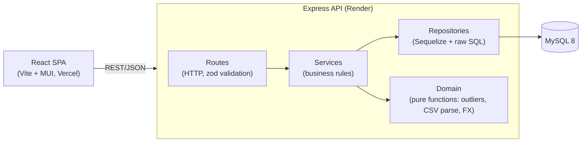

# Design Notes

## 1. Architecture

**Layer rules** (this is what keeps tests fast):

- Routes only translate HTTP <-> service calls and validate input. No business logic.
- Services hold business rules and talk to repositories through interfaces.
- `domain/` is pure TypeScript with no I/O, so it is unit-tested with no DB and no HTTP.
- Repositories are the only layer that knows Sequelize/SQL.

**Repo layout:** npm workspaces monorepo: `apps/api`, `apps/web`, `docs/`.

## 2. Data model

`employees`

| column                  | type           | notes                     |
| ----------------------- | -------------- | ------------------------- |
| id                      | BIGINT PK auto |                           |
| full_name               | VARCHAR(120)   |                           |
| email                   | VARCHAR(190)   | UNIQUE                    |
| job_title               | VARCHAR(100)   |                           |
| department              | VARCHAR(100)   |                           |
| country_code            | CHAR(2)        | ISO 3166-1                |
| currency_code           | CHAR(3)        | FK -> currency_rates.code |
| annual_salary           | DECIMAL(14,2)  | local currency, > 0       |
| hire_date               | DATE           |                           |
| created_at / updated_at | DATETIME       |                           |

`currency_rates`: `code` PK, `rate_to_usd DECIMAL(18,8)`. Seeded with a static table (10 currencies).

**Indexes:** `UNIQUE(email)`, `(country_code)`, `(department)`, `(job_title, country_code)`, `(full_name)`.

## 3. API (REST, JSON, `/api/v1`)

| Method & path                                                                             | Purpose                                                                                                                                                 |
| ----------------------------------------------------------------------------------------- | ------------------------------------------------------------------------------------------------------------------------------------------------------- |
| `GET /employees?page&pageSize&q&country&department&jobTitle&sort&order`                   | Paginated directory (F1); `pageSize` max 100; sort by name, title, department, country, hire date, USD salary                                           |
| `GET /employees/:id`                                                                      | One employee                                                                                                                                            |
| `POST /employees`                                                                         | Create (F2)                                                                                                                                             |
| `PUT /employees/:id`                                                                      | Update (F2)                                                                                                                                             |
| `DELETE /employees/:id`                                                                   | Delete (F2), 204                                                                                                                                        |
| `POST /employees/import`                                                                  | CSV import (F7). Body is the file text with `Content-Type: text/csv`. Returns `{totalRows, imported, skipped, errors:[{row,message}], errorsTruncated}` |
| `GET /insights/summary?groupBy=country\|department\|jobTitle&country&department&jobTitle` | headcount/min/median/avg/max in USD (F3)                                                                                                                |
| `GET /insights/distribution?bands&country&department&jobTitle`                            | Histogram buckets with a round band size (F4)                                                                                                           |
| `GET /insights/outliers?country&department&jobTitle&limit`                                | Employees outside their peer group's fences, with fences and % deviation (F5)                                                                           |
| `GET /meta/filters`                                                                       | Distinct countries/departments/job titles for dropdowns                                                                                                 |
| `GET /meta/currencies`                                                                    | Currencies that have an exchange rate (for the employee form)                                                                                           |
| `GET /health`                                                                             | Liveness check                                                                                                                                          |

**Errors** use one shape: `{ "error": { "code", "message", "details?" } }`. Status codes: 400 validation (with per-field `details`), 404 missing, 409 duplicate email, 413 file over 5 MB.

## 4. Key decisions and trade-offs

| #   | Decision                                                                                                                                         | Alternatives                             | Why                                                                                                                                                                                                                                                                                                                                                                                                                                                      |
| --- | ------------------------------------------------------------------------------------------------------------------------------------------------ | ---------------------------------------- | -------------------------------------------------------------------------------------------------------------------------------------------------------------------------------------------------------------------------------------------------------------------------------------------------------------------------------------------------------------------------------------------------------------------------------------------------------- |
| D1  | Express + layered structure                                                                                                                      | NestJS                                   | Less boilerplate; layering shown by hand is easier to explain                                                                                                                                                                                                                                                                                                                                                                                            |
| D2  | MySQL + Sequelize                                                                                                                                | SQLite, Prisma                           | Chosen stack; needs a hosted DB in prod (see D8)                                                                                                                                                                                                                                                                                                                                                                                                         |
| D3  | `DECIMAL(14,2)` for salary, never float                                                                                                          | FLOAT, integer cents                     | Exact money. Sequelize returns DECIMAL as a string, so the repository maps it to a number at the boundary (safe: below 2^53).                                                                                                                                                                                                                                                                                                                            |
| D4  | USD computed at query time (join to `currency_rates`)                                                                                            | Stored `salary_usd` column               | A stored value goes stale when a rate changes. 10k-row join is cheap.                                                                                                                                                                                                                                                                                                                                                                                    |
| D5  | Aggregates and median in **raw SQL** (window functions)                                                                                          | Fetch all rows and compute in JS         | Runs in the DB, scales beyond 10k, and returns small payloads. MySQL 8 has no `MEDIAN()`, so it uses `ROW_NUMBER()`/`COUNT() OVER`. ORM cannot express this, so it lives in a documented raw query in the repository.                                                                                                                                                                                                                                    |
| D6  | Outlier rule: Tukey fences (Q1 - 1.5 IQR, Q3 + 1.5 IQR) per (job title, country), min peer group of 5                                            | z-score                                  | Robust to the outliers themselves; groups too small to judge are skipped, not flagged                                                                                                                                                                                                                                                                                                                                                                    |
| D7  | Server-side pagination, filters, sorting (offset/limit)                                                                                          | Client-side on the full list             | 10k rows should not ship to the browser. Offset is fine at this size; keyset pagination is the upgrade at 1M.                                                                                                                                                                                                                                                                                                                                            |
| D8  | Vercel (UI) + Render (API) + TiDB Cloud Starter (database)                                                                                       | Single service; Aiven/PlanetScale        | Split deployment, so CORS is an explicit allow-list (`CORS_ORIGIN`) and the API URL is a build-time `VITE_API_URL`. Aiven retired its free MySQL (Nov 2026) and PlanetScale has no free plan, so TiDB Starter (MySQL-compatible, free allowance) is used. It requires TLS and has a case-sensitive default collation; see D12.                                                                                                                           |
| D9  | zod for validation, one schema reused for create, update and CSV rows                                                                            | Hand-written checks                      | A single source of truth, so CSV rows and form input obey the same rules                                                                                                                                                                                                                                                                                                                                                                                 |
| D10 | Department/job title as plain strings                                                                                                            | Lookup tables                            | Less schema for v1; dropdown values come from `DISTINCT` via `/meta/filters`. Normalizing is a roadmap item.                                                                                                                                                                                                                                                                                                                                             |
| D11 | Seed uses a seeded PRNG (fixed seed) and batch `bulkCreate`                                                                                      | Random each run                          | Reproducible data makes tests and demos deterministic; batches keep 10k inserts fast                                                                                                                                                                                                                                                                                                                                                                     |
| D12 | Directory search is a **contains** match (`LIKE %q%`) on name or email, with `%`/`_` escaped                                                     | Prefix match (`LIKE q%`, index-friendly) | Users type last names, which prefix search misses. Both sides are lower-cased (`LOWER(col) LIKE ...`) so the result does not depend on the database collation: MySQL's default is case-insensitive but TiDB's is case-sensitive, which the integration suite caught when run against TiDB. A contains-search cannot use an index, but scans 10k rows in about 16 ms (see `performance.md`). Full-text or a trigram index is the upgrade at larger scale. |
| D13 | CSV import is **partial**: valid rows are inserted, invalid ones reported by row number; the valid rows go in one transaction                    | Reject the whole file on any error       | One typo should not block 9,999 good rows. The transaction means no half-imported valid set. File-level problems (missing columns, empty, over 20,000 rows) still reject the whole file.                                                                                                                                                                                                                                                                 |
| D14 | CSV is sent as a `text/csv` request body, not multipart                                                                                          | multer / multipart upload                | No extra dependency; the browser reads the file and sends its text. 5 MB limit, 413 beyond it.                                                                                                                                                                                                                                                                                                                                                           |
| D15 | Import is insert-only; an existing email is skipped                                                                                              | Upsert by email                          | Safer first version: an import can never silently overwrite pay. Update-by-email is on the roadmap.                                                                                                                                                                                                                                                                                                                                                      |
| D16 | Plain MUI Table with server-side paging/sorting                                                                                                  | MUI DataGrid                             | The server owns the data, so the grid's client features go unused and its server mode adds state syncing. DataGrid is the upgrade if Excel-like column/cell editing is wanted.                                                                                                                                                                                                                                                                           |
| D17 | Frontend data fetching through one small hook (`useAsync`): aborts stale requests, ignores late responses, keeps the previous data while loading | React Query / SWR                        | Three behaviours were needed, so a 40-line tested hook beat a dependency. React Query is the upgrade if caching or mutations grow.                                                                                                                                                                                                                                                                                                                       |
| D18 | Hand-written API types in the web app                                                                                                            | Shared package / OpenAPI client          | Two small apps; a shared package costs more than it saves. Generated client is the upgrade.                                                                                                                                                                                                                                                                                                                                                              |
| D19 | Insights page lazy-loaded                                                                                                                        | Single bundle                            | Keeps the charting library (about 428 kB) off the directory's first load                                                                                                                                                                                                                                                                                                                                                                                 |
| D20 | Migrations (umzug) instead of `sequelize.sync()`                                                                                                 | `sync()`                                 | `sync()` cannot evolve a production schema safely                                                                                                                                                                                                                                                                                                                                                                                                        |

## 5. Testing strategy

Three tiers, about 150 tests in total.

- **API unit tests (`npm test -w apps/api`, no database, about 1 s):** `domain/` rules (validation, outlier fences, histogram bands, CSV parsing, seed generator) and services against an in-memory fake repository, plus HTTP contract tests (real routes, validation and error handler, fake repository).
- **API integration tests (`npm run test:integration -w apps/api`, MySQL `salary_test`):** the repositories, because the raw SQL (median, quartiles, USD sorting, transactional import, filters, stable pagination) can only be verified against a real database. Expected values are computed by hand in the test. A guard refuses to run against a database whose name does not contain "test".
- **Web tests (`npm test -w apps/web`, jsdom, `fetch` mocked):** pure logic (form validation, API error mapping, formatting, CSV helpers), the `useAsync` hook (including the stale-response case), and component flows (directory, create/edit/delete, insights, import).
- Fast and deterministic: no network, a seeded random generator, fixed FX rates in tests, no dependence on today's date.

## 6. Performance considerations

Measured numbers are in [performance.md](performance.md). Summary of the approach:

- All filtering, sorting, paging and aggregation happens in SQL; the browser never receives more than 100 employees.
- Indexes on the filter and group-by columns; the median and quartiles use window functions, so the database returns a few dozen rows instead of 10,000.
- Measured on the seeded 10k dataset: every endpoint's p95 is well under the 500 ms target (slowest: outliers at about 125 ms).

## 7. Build order and status

Each step was a small commit, tests alongside the code.

1. Monorepo scaffold, lint/format, test runners (done)
2. DB config, Sequelize models, migrations, seed (10k) and FX table (done)
3. Employee CRUD and list/filter API (done)
4. Insights API: summary, distribution, outliers (done)
5. CSV import (done)
6. React UI: directory, form, insights, import (done)
7. Docs, deployment, demo video

## 8. Known limitations (deliberate, see requirements for the full scope)

- No authentication; salary data is sensitive, so this is the first thing to add before real use.
- Offset pagination (fine at 10k; keyset pagination at much larger scale).
- Contains-search scans the table (about 16 ms at 10k).
- Static exchange rates; no salary history or audit log.
- CSV import only adds people; it never updates existing ones.
- Main JS bundle is about 614 kB (193 kB gzipped), mostly MUI.
