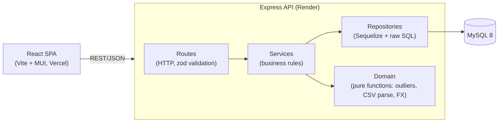

# Design Notes

## 1. Architecture

**Layer rules** (this is what keeps tests fast):

- Routes only translate HTTP <-> service calls and validate input. No business logic.
- Services hold business rules and talk to repositories through interfaces.
- `domain/` is pure TypeScript with no I/O, so it is unit-tested with no DB and no HTTP.
- Repositories are the only layer that knows Sequelize/SQL.

**Repo layout:** npm workspaces monorepo: `apps/api`, `apps/web`, `docs/`.

## 2. Data model

`employees`

| column                  | type           | notes                     |
| ----------------------- | -------------- | ------------------------- |
| id                      | BIGINT PK auto |                           |
| full_name               | VARCHAR(120)   |                           |
| email                   | VARCHAR(190)   | UNIQUE                    |
| job_title               | VARCHAR(100)   |                           |
| department              | VARCHAR(100)   |                           |
| country_code            | CHAR(2)        | ISO 3166-1                |
| currency_code           | CHAR(3)        | FK -> currency_rates.code |
| annual_salary           | DECIMAL(14,2)  | local currency, > 0       |
| hire_date               | DATE           |                           |
| created_at / updated_at | DATETIME       |                           |

`currency_rates`: `code` PK, `rate_to_usd DECIMAL(18,8)`, `updated_at`. Seeded with a static table.

**Indexes:** `UNIQUE(email)`, `(country_code)`, `(department)`, `(job_title, country_code)`, `(full_name)`.

## 3. API (REST, JSON, `/api/v1`)

| Method & path                                                                    | Purpose                                                        |
| -------------------------------------------------------------------------------- | -------------------------------------------------------------- |
| `GET /employees?page&pageSize&q&country&department&jobTitle&sort`                | Paginated directory (F1)                                       |
| `GET /employees/:id`                                                             | One employee                                                   |
| `POST /employees`                                                                | Create (F2)                                                    |
| `PUT /employees/:id`                                                             | Update (F2)                                                    |
| `DELETE /employees/:id`                                                          | Delete (F2)                                                    |
| `POST /employees/import`                                                         | CSV upload; returns `{imported, errors:[{row, message}]}` (F7) |
| `GET /insights/summary?groupBy=country\|department\|jobTitle&country&department` | headcount/min/median/avg/max in USD (F3)                       |
| `GET /insights/distribution?bands&country&department`                            | Histogram buckets (F4)                                         |
| `GET /insights/outliers?country&department`                                      | Employees outside their peer group's fences (F5)               |
| `GET /meta/filters`                                                              | Distinct countries/departments/job titles for dropdowns        |

**Errors** use one shape: `{ "error": { "code", "message", "details?" } }`, with 400 for validation, 404 for missing, 409 for a duplicate email.

## 4. Key decisions and trade-offs

| #   | Decision                                                                                              | Alternatives                     | Why                                                                                                                                                                                                                   |
| --- | ----------------------------------------------------------------------------------------------------- | -------------------------------- | --------------------------------------------------------------------------------------------------------------------------------------------------------------------------------------------------------------------- |
| D1  | Express + layered structure                                                                           | NestJS                           | Less boilerplate; layering shown by hand is easier to explain                                                                                                                                                         |
| D2  | MySQL + Sequelize                                                                                     | SQLite, Prisma                   | Chosen stack; needs a hosted DB in prod (see D8)                                                                                                                                                                      |
| D3  | `DECIMAL(14,2)` for salary, never float                                                               | FLOAT, integer cents             | Exact money. Sequelize returns DECIMAL as a string, so the repository maps it to a number at the boundary (safe: below 2^53).                                                                                         |
| D4  | USD computed at query time (join to `currency_rates`)                                                 | Stored `salary_usd` column       | A stored value goes stale when a rate changes. 10k-row join is cheap.                                                                                                                                                 |
| D5  | Aggregates and median in **raw SQL** (window functions)                                               | Fetch all rows and compute in JS | Runs in the DB, scales beyond 10k, and returns small payloads. MySQL 8 has no `MEDIAN()`, so it uses `ROW_NUMBER()`/`COUNT() OVER`. ORM cannot express this, so it lives in a documented raw query in the repository. |
| D6  | Outlier rule: Tukey fences (Q1 - 1.5 IQR, Q3 + 1.5 IQR) per (job title, country), min peer group of 5 | z-score                          | Robust to the outliers themselves; groups too small to judge are skipped, not flagged                                                                                                                                 |
| D7  | Server-side pagination, filters, sorting (offset/limit)                                               | Client-side on the full list     | 10k rows should not ship to the browser. Offset is fine at this size; keyset pagination is the upgrade at 1M.                                                                                                         |
| D8  | Vercel (UI) + Render (API) + hosted MySQL                                                             | Single service                   | Chosen split; needs CORS config and `VITE_API_URL`. Free MySQL host to be decided at deploy time.                                                                                                                     |
| D9  | zod for validation, one schema reused for create, update and CSV rows                                 | Hand-written checks              | A single source of truth, so CSV rows and form input obey the same rules                                                                                                                                              |
| D10 | Department/job title as plain strings                                                                 | Lookup tables                    | Less schema for v1; dropdown values come from `DISTINCT` via `/meta/filters`. Normalizing is a roadmap item.                                                                                                          |
| D11 | Seed uses a seeded PRNG (fixed seed) and batch `bulkCreate`                                           | Random each run                  | Reproducible data makes tests and demos deterministic; batches keep 10k inserts fast                                                                                                                                  |

## 5. Testing strategy

- **Unit (fast, no I/O, majority of tests):** `domain/` (outlier fences, quartiles, currency conversion, CSV row parsing, validation schemas) and services against in-memory fake repositories.
- **Integration (few, still deterministic):** repositories + routes against a dedicated MySQL test database (`salary_test`), reset per suite. These cover the raw SQL (median/percentiles) and HTTP contracts via supertest.
- **Frontend:** component tests for the filter/table logic and the form validation (Vitest + Testing Library).
- Tooling: Vitest in both apps. No network, fixed seeds, no clock dependence (inject the date where needed).

## 6. Performance considerations

- All list/aggregate work is done in SQL with indexes on the filter columns; the page size is capped (max 100).
- Search is `LIKE 'term%'` on name/email so the index can be used (contains-search on 10k rows is also acceptable; noted as a trade-off).
- Target: under 500 ms for list and insights on 10k rows. This will be measured and recorded in `docs/performance.md` after the seed is built.
- Insights responses are small (grouped rows or buckets), so they need no caching at this size.

## 7. Build order (each step = small commits, tests first)

1. Monorepo scaffold, lint/format, test runners
2. DB config, Sequelize models, migrations, seed (10k) + FX table
3. Domain functions (TDD): currency, quartiles/outliers, CSV parsing, validation
4. Employee CRUD + list/filter API
5. Insights API (summary, distribution, outliers)
6. CSV import
7. React UI: directory, form, insights, import
8. Deploy, README, demo video
